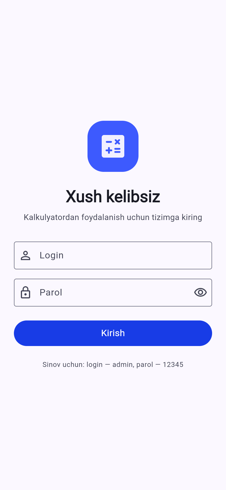
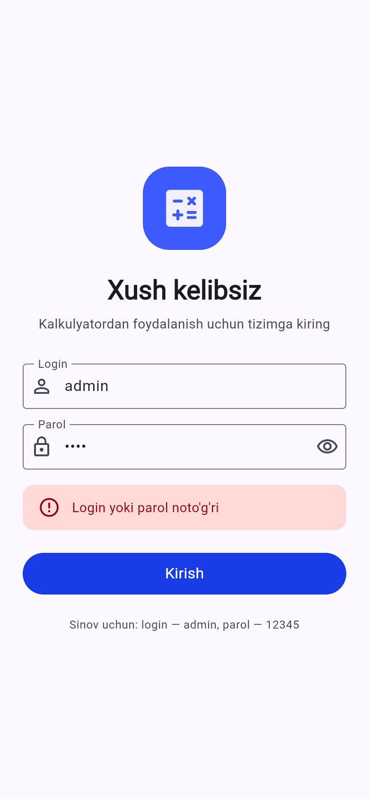
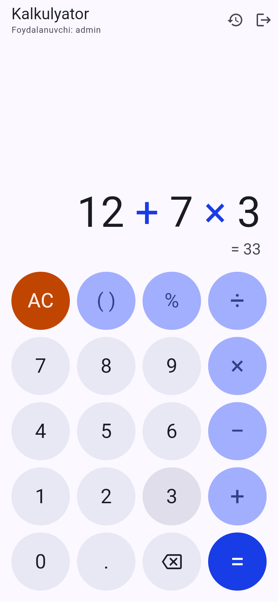
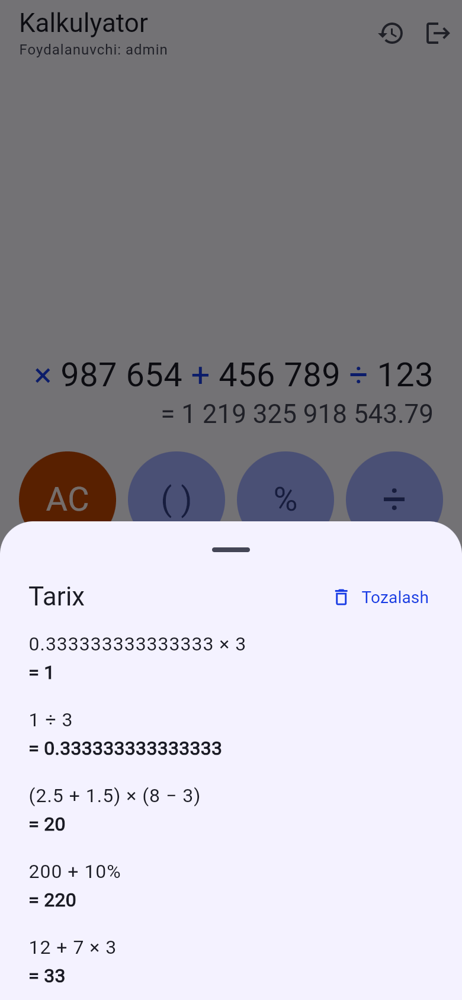
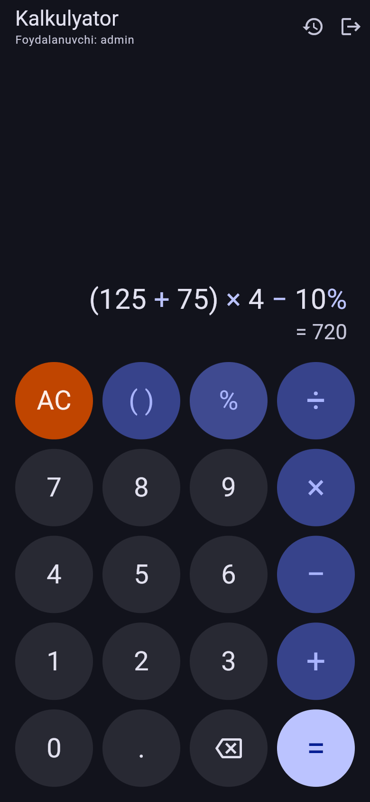
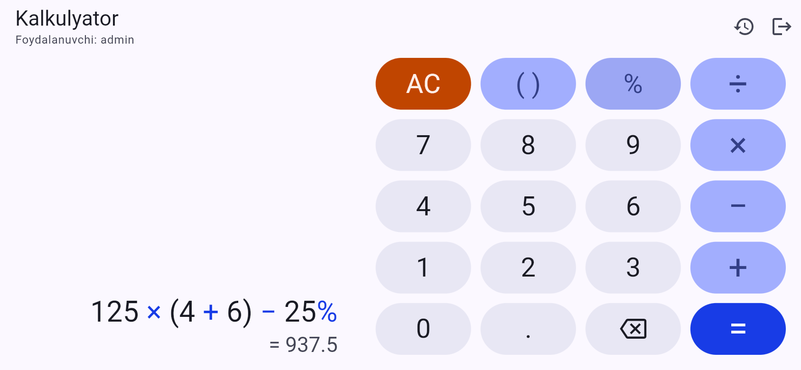

# Kalkulyator — Amaliy topshiriq 1

[](https://github.com/xNITE-oss/uni-mobile-app/actions/workflows/build.yml)

Flutter'da yozilgan mobil ilova (Android va iOS). Topshiriqning ikkala bandi bitta ilovada bajarilgan:

1. **Kalkulyator dasturi** — to'liq ishlaydigan kalkulyator.
2. **Login oynasi** — ilova login oynasi bilan ochiladi, to'g'ri login va parol kiritilgach kalkulyatorga o'tadi.

## Skrinshotlar

| Login oynasi | Xato xabari | Kalkulyator | Tarix | Qorong'i mavzu |
| :---: | :---: | :---: | :---: | :---: |
|  |  |  |  |  |

Telefon yotiq holatda bo'lsa, ekran chapda, tugmalar o'ngda joylashadi:



## Sinov uchun login va parol

| Login | Parol |
| --- | --- |
| `admin` | `12345` |

Bu o'quv loyihasi bo'lgani uchun login va parol kodning o'zida turadi ([`lib/logic/auth_service.dart`](lib/logic/auth_service.dart)). Haqiqiy ilovada ular serverda tekshiriladi.

## Imkoniyatlar

### Login oynasi

- Login va parol maydonlari, "Kirish" tugmasi.
- Bo'sh maydon uchun ogohlantirish: "Loginni kiriting", "Parolni kiriting".
- Noto'g'ri login yoki parolda xato xabari.
- Parolni ko'rsatish va yashirish tugmasi.
- Kalkulyator oynasidagi "Chiqish" tugmasi tasdiq so'rab, login oynasiga qaytaradi.

### Kalkulyator

- To'rt amal: `+`, `−`, `×`, `÷`, amallar tartibi bilan (`2 + 3 × 4 = 14`).
- Qavslar, shu jumladan ichma-ich: `(2 + 3) × 4 = 20`.
- O'nli kasrlar va manfiy sonlar: `5 × −3 = −15`.
- Foiz: `200 + 10% = 220`, `200 × 10% = 20`.
- **Aniq hisob**: `0.1 + 0.2 = 0.3`, `1 ÷ 3 × 3 = 1` (yaxlitlash xatosi yo'q).
- Terish paytida natija oldindan ko'rinib turadi.
- Nolga bo'lish va tugallanmagan ifoda uchun tushunarli xabar; ifoda o'chib ketmaydi.
- `⌫` oxirgi belgini o'chiradi (uzoq bosilsa — hammasini), `AC` hammasini tozalaydi.
- Hisoblar tarixi: eski natijani bosib, u bilan hisobni davom ettirish mumkin.
- Ekranni uzoq bosib turish natijani nusxalaydi.
- Katta sonlarda minglik xonalar ajratiladi: `1 234 567.5`.
- Yorug' va qorong'i mavzu (telefon sozlamasiga qarab), tik va yotiq holat.

## Telefonga o'rnatish (APK)

Har bir o'zgarishdan keyin GitHub Actions ilovani avtomatik yig'adi. Tayyor APK shu yerda:

**[Releases → kalkulyator.apk](https://github.com/xNITE-oss/uni-mobile-app/releases/latest)**

Faylni Android telefonga yuklab oching va o'rnatishga ruxsat bering.

## Kompyuterda ishga tushirish

Kerak bo'ladi: [Flutter](https://docs.flutter.dev/get-started/install) 3.50 yoki undan yangi versiya.

```bash
git clone https://github.com/xNITE-oss/uni-mobile-app.git
cd uni-mobile-app
flutter pub get
flutter run
```

Emulyator yoki telefon bo'lmasa, brauzerda ham ochish mumkin:

```bash
flutter run -d chrome
```

## Testlar

```bash
flutter test
```

Loyihada 155 ta avtomatik test bor:

| Fayl | Nimani tekshiradi | Testlar |
| --- | --- | ---: |
| [`test/rational_test.dart`](test/rational_test.dart) | Aniq kasr sonlar va ularni yozish | 19 |
| [`test/calculator_engine_test.dart`](test/calculator_engine_test.dart) | Kalkulyator mantig'i: amallar, qavslar, foiz, xatolar, tarix | 102 |
| [`test/app_test.dart`](test/app_test.dart) | Login va kalkulyator oynalari, turli ekran o'lchamlari | 34 |

## Loyiha tuzilishi

```
lib/
├── main.dart                     # Ilovaning kirish nuqtasi, mavzu (ranglar)
├── logic/
│   ├── auth_service.dart         # Login va parolni tekshirish
│   ├── calculator_engine.dart    # Kalkulyator mantig'i (Flutter'ga bog'liq emas)
│   └── rational.dart             # Aniq kasr sonlar (surat / maxraj)
└── screens/
    ├── login_screen.dart         # Login oynasi
    └── calculator_screen.dart    # Kalkulyator oynasi
test/                             # Avtomatik testlar
.github/workflows/build.yml       # Test va APK yig'ish (GitHub Actions)
```

## Qanday ishlaydi

**Oynalar orasida o'tish.** Login to'g'ri bo'lsa, `Navigator.pushReplacement` kalkulyator oynasini ochadi va login oynasini yopadi, shuning uchun "orqaga" tugmasi login oynasiga qaytarmaydi. "Chiqish" bosilganda xuddi shu usulda login oynasi qayta ochiladi.

**Mantiq va ko'rinish ajratilgan.** `CalculatorEngine` sinfi tugma bosilishlarini qabul qiladi va ekranga chiqadigan matnni beradi. Oyna (`CalculatorScreen`) faqat shu matnni ko'rsatadi. Shu tufayli mantiqni ekransiz, oddiy testlar bilan tekshirish mumkin.

**Ifodani hisoblash.** Ifoda bo'laklar (son, amal, qavs, foiz) ro'yxati sifatida saqlanadi. "=" bosilganda rekursiv tushish usulidagi tahlilchi uni amallar tartibiga rioya qilib hisoblaydi.

**Aniqlik.** Sonlar `double` emas, oddiy kasr (`BigInt` surat va maxraj) ko'rinishida saqlanadi. Shuning uchun `0.1 + 0.2` aynan `0.3` chiqadi. Natija ekranga 15 ta ma'noli raqamgacha yaxlitlab chiqariladi, lekin keyingi hisob uchun aniq qiymat saqlanib qoladi.

**Foiz qoidalari** (oddiy kalkulyatorlardagidek):

| Ifoda | Natija | Izoh |
| --- | ---: | --- |
| `200 + 10%` | 220 | 200 ga uning 10 foizi qo'shiladi |
| `200 − 10%` | 180 | 200 dan uning 10 foizi ayiriladi |
| `200 × 10%` | 20 | 200 ning 10 foizi |
| `200 ÷ 10%` | 2 000 | 200 ni 0.1 ga bo'lish |
| `50%` | 0.5 | sonning yuzdan biri |
